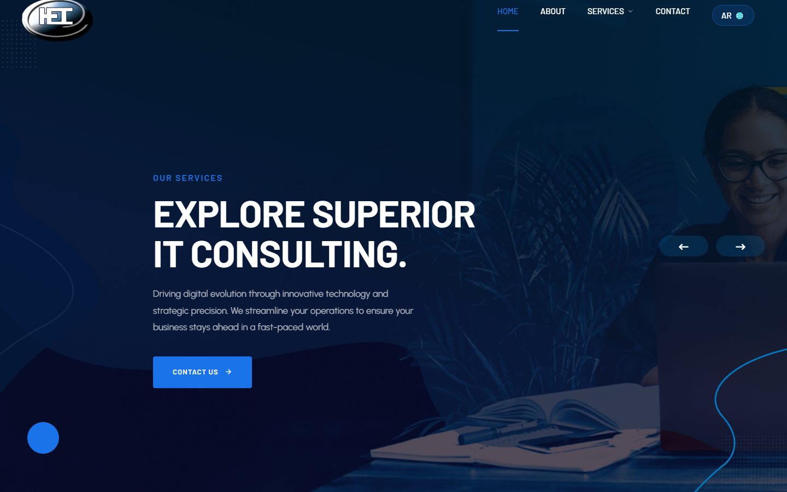

# Helzeia — IT Solutions Corporate Website

A full-featured, bilingual (English / Arabic with RTL support) corporate website for **Helzeia**, an IT solutions company offering web development, mobile applications, hosting, and complete IT support services.

## 🛠️ Tech Stack

- **HTML5 & CSS3** — semantic multi-page structure, custom styling, RTL support
- **Bootstrap 5.3** — responsive grid and components
- **Swiper.js 11** — touch-enabled slider
- **Bootstrap Icons & Font Awesome 6.7** — dual icon sets
- **Barlow + Open Sans** — Google Fonts typography
- **Vanilla JavaScript** — all interactions, zero dependencies

## 📄 Pages (EN + AR)

- `index.html` / `index-ar.html` — Home
- `about-us-en.html` / `about-us-ar.html` — About
- `services.html` — Services overview
- `programing-en.html`, `mobile-app-en.html`, `web-design-en.html` — Service pages
- `hosting-en.html`, `mail-support-en.html`, `startup-package-en.html`
- `software-support-en.html`, `remote-app-en.html`, `hardware-maintenance-en.html`
- `contact-us-en.html` / `contact-us-ar.html` — Contact

⚠️ This template was originally created by Mohammed Sabry
credit is required: github.com/Mohammedsabry13

## ✨ Features

- Animated preloader with brand logo spinner

- Ken Burns hero slider (4 slides, auto-advance every 8s)
- Smart desktop dropdown navbar with hover delay & bridge gap
- Mobile drawer menu with services accordion
- Feature cards with hover-to-activate interaction
- FAQ accordion with smooth max-height animation
- Star field background animation (canvas-free, pure CSS/JS)
- Bilingual language toggle (EN ⇄ AR) with RTL layout switching
- Back-to-top button (bilingual, keyboard accessible)
- Fully responsive across all screen sizes
